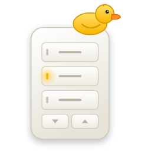

<p align="center"></p>

# 🎛️ Keypad Builder

A visual editor for keypad button automations in Home Assistant. Made for **Lutron RA3** (and Caséta / Picos), but it can work with any device that has button triggers.

Pick a keypad → tap a button on the faceplate → choose what it does → **Save**. That's it ✨

## What it does

- Adds a **Keypad Builder** page to your sidebar (admins only)
- Lists your Lutron keypads, grouped by room, with clean names ("Entry" instead of "Patrick's Office Entry Position 1 Keypad") and readable types like "Sunnata keypad"
- Pick what to control from a searchable list you can filter by **room** and **type** (lights, shades, scenes…)
- Shows each keypad as a faceplate you can click, in a **Sunnata, seeTouch, Pico or Classic** style (picked automatically from the model, or chosen by you)
- **Ganged wallboxes:** keypads in the same box ("Position 1 / 2 / 3") show side by side in one multi-gang wallplate
- ✋ **Drag and drop:** move buttons around the keypad, and reorder action steps
- 🧱 **Device tiles:** pick what to control from tiles with checkboxes, filter by room and type, and control several things in one step
- Lets you set separate actions for **pressed** and **released**
- Each button + press/release is saved as a **normal Home Assistant automation**, so you can still see and edit it in *Settings → Automations*
- A green dot shows which buttons already have something set up
- 📡 **Pulls your RA3 programming:** button order and engraving text come straight from your Lutron processor (whatever you set up in Lutron Designer)
- ✏️ **Layout editor:** drag buttons around, rename or hide them, and pick a style and finish (white, ivory, gray, black, brass, nickel, smoked glass, frosted glass)
- 💡 **LED control:** make a button's LED follow any device (like "LED on when the kitchen lights are on"), or turn LEDs on/off as button actions. Faceplate LEDs glow live in the panel
- 🔧 **Works with HA's automation editor:** open any button's automation in the full HA editor to add conditions or fancy steps, and Keypad Builder keeps them
- 🔗 **Existing automations:** fire any automation you already have from a button ("Run another automation"), and see which other automations already use each button (blue dot), with links to open them
- 🔗 **Shared actions:** pick buttons from any keypads and give them one set of actions ("Movie time" on the bedroom, office and living room keypads). It's one automation, so you change it once and every button updates. Start one from scratch, or from a button with "Share this button's actions…"
- 📥 **Import existing automations:** bring automations you made before into the builder with one tap. They keep their name, conditions and settings
- 🔢 **See what's set up:** keypads show a "3 set up" badge, and you can sort by **Set up first**
- 🗂️ **Organized automations:** each one gets its keypad's **area**, a **Keypads** category and a **Keypad Builder** label, plus names that sort nicely ("Patrick's Office · Entry · Bright · pressed"). If a keypad moves rooms, its automations follow. Tap 🧹 to tidy up ones made with older versions
- 💎 **Liquid glass look** (the default), plus Match Home Assistant, Light and Dark. Tap the button in the top right to switch

### Actions you can pick

Toggle · Turn on · Turn off · Set light brightness (with fade) · Activate scene · Run script · Run another automation · Keypad LED on/off/toggle · Open/close/stop shade · Play/pause · Volume up/down · Wait · Custom action (any action + JSON data)

Steps the builder doesn't understand (like `choose` blocks you added in the HA editor) are shown as JSON and kept as-is.

## About pulling from the RA3 program

Home Assistant's Lutron integration already reads your keypads from the RA3 processor over LEAP, including the **engraving text** and **button numbers** you programmed in Lutron Designer. Keypad Builder uses that to show buttons in their real order with their real names. If you change engravings in Designer, transfer to the processor, reload the Lutron integration in HA, then hit ↻ in Keypad Builder.

The Designer project file itself (`.ra3`) is a locked Lutron format, so it can't be imported directly. The processor is the source of truth anyway 💁

Layouts you edit are saved in Home Assistant (`.storage/keypad_builder.layouts`), so they show up on every device you use.

## About LEDs

RA3 keypad LEDs show up in Home Assistant as `switch` entities (e.g. `switch.kitchen_keypad_dinner_led`). Keypad Builder finds the right one for each button automatically.

"LED follows a device" saves a small automation (`keypad_builder_<device>_<button>_led`) that sets the LED whenever that device changes, and when HA starts. Your RA3 processor can still change LEDs too (like when a Lutron scene runs), so for buttons that run Lutron scenes, it's usually best to leave the LED on "What Lutron programmed".

## Requirements

- Home Assistant **2024.10** or newer
- The **Lutron Caséta** integration set up with your RA3 processor (it handles RA3 / HomeWorks QSX too)
- `automation: !include automations.yaml` in your config (this is the default)

## Install with HACS

1. HACS → ⋮ → **Custom repositories**
2. Add this repo's URL, category **Integration**
3. Install **Keypad Builder** and restart Home Assistant
4. *Settings → Devices & services → Add integration →* **Keypad Builder**
5. Open **Keypad Builder** in the sidebar 🎉

## Manual install

Copy `custom_components/keypad_builder` into your HA `config/custom_components/` folder, restart, then do step 4 above.

## How automations are named

Automation IDs look like `keypad_builder_<device id>_<button>_<press|release|led>`. Saving a button with no actions removes its automation. You can rename them in HA and the builder keeps your name.

## Development

```bash
pip install pytest-homeassistant-custom-component pylutron-caseta
pytest
```

## License

MIT, see [LICENSE](LICENSE). (The Muscovy Public License in the file headers is just a joke 🦆)
